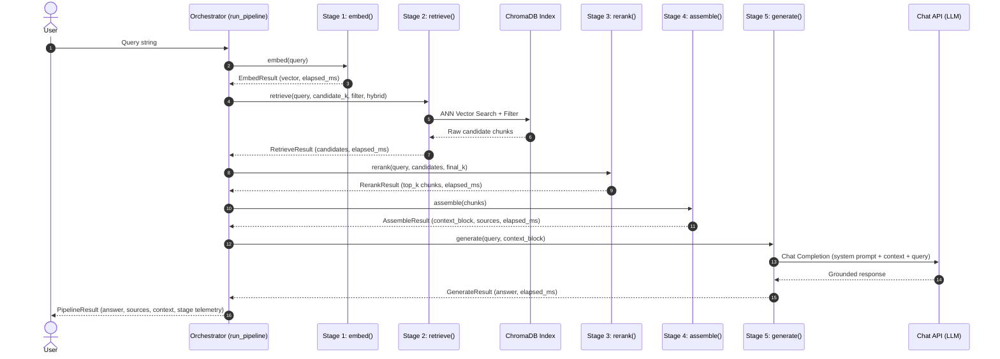

# RAG Pipeline Architecture & Flow Design

## 1. Overview & Objectives

The BuildGuard RAG pipeline connects the modular components of the system into an end-to-end, reproducible query-to-answer architecture for the National Building Code of India (NBC). It takes an engineer's or architect's natural-language query, embeds it into a dense vector space, retrieves candidate chunks using hybrid search against a persistent vector index, re-ranks the candidates for precision, constructs a structured grounded-context block, and prompts an LLM to generate an authoritative answer strictly cited back to NBC volume and page numbers.

### Key Architectural Goals
- **Strict Grounding & Hallucination Mitigation:** All generated answers are constrained to supplied context blocks; no extrapolation or unverifiable statements are permitted.
- **Stage Separation & Single Responsibility:** Each step (`embed`, `retrieve`, `rerank`, `assemble`, `generate`) is an independent, pure or lightly stateful function with typed dataclass outputs.
- **Precision Re-ranking:** A two-stage retriever (`candidate_k` → `final_k`) pairs broad bi-encoder recall with cross-encoder / multi-factor precision.
- **Traceability & Auditing:** The pipeline returns structured source metadata (chunk IDs, PDF source, volume, page numbers, headings, similarity scores) along with execution timing for every stage.

---

## 2. End-to-End Flow Diagram

```
                             +------------------------+
                             |   User Query (str)     |
                             +------------------------+
                                         |
                                         v
                     +----------------------------------------+
                     |  Stage 1: EMBED                        |
                     |  - SentenceTransformer bi-encoder      |
                     |  - L2 normalisation                    |
                     |  - Output: 384-d dense query vector   |
                     +----------------------------------------+
                                         |
                                         v
                     +----------------------------------------+
                     |  Stage 2: RETRIEVE                     |
                     |  - Persistent ChromaDB vector index    |
                     |  - Metadata filter (heading/section)   |
                     |  - Optional lexical keyword boost      |
                     |  - Output: candidate_k (e.g. 10) pool  |
                     +----------------------------------------+
                                         |
                                         v
                     +----------------------------------------+
                     |  Stage 3: RERANK                       |
                     |  - CrossEncoder or custom precision    |
                     |  - Full query-document pair scoring    |
                     |  - Output: final_k (e.g. 3) top chunks |
                     +----------------------------------------+
                                         |
                                         v
                     +----------------------------------------+
                     |  Stage 4: ASSEMBLE                     |
                     |  - Ranked chunk formatting             |
                     |  - Source attribution & metadata tags  |
                     |  - Output: Grounded context block      |
                     +----------------------------------------+
                                         |
                                         v
                     +----------------------------------------+
                     |  Stage 5: GENERATE                     |
                     |  - System prompt: strict NBC citation  |
                     |  - OpenAI-compatible Chat API call     |
                     |  - Dry-run synthetic fallback mode     |
                     |  - Output: Grounded answer string      |
                     +----------------------------------------+
                                         |
                                         v
                             +------------------------+
                             |     PipelineResult     |
                             | - answer               |
                             | - sources list         |
                             | - context_block        |
                             | - stage metrics (ms)   |
                             +------------------------+
```

### Mermaid Sequence



---

## 3. Detailed Stage Breakdown

### Stage 1: EMBED (`embed`)
- **Input:** `query: str`, `model_name: str = DEFAULT_MODEL`, `device: str | None`
- **Output:** `EmbedResult(query, vector, model_name, elapsed_ms)`
- **Responsibility:**
  - Encodes the user's natural language question into a 384-dimensional dense vector using `sentence-transformers/multi-qa-MiniLM-L6-dot-v1`.
  - Normalises the vector using L2 norm so that dot product equals cosine similarity, matching the corpus index vectors created in `embed_text_chunks.py`.
  - Re-uses cached models across invocations to avoid initialization overhead.

### Stage 2: RETRIEVE (`retrieve`)
- **Input:** `query: str`, `candidate_k: int = 10`, `metadata_filter: dict | None`, `hybrid: bool = True`, `keywords: list[str] | None`, `score_threshold: float | None`
- **Output:** `RetrieveResult(query, candidates, candidate_k, metadata_filter, hybrid, elapsed_ms)`
- **Responsibility:**
  - Performs Approximate Nearest Neighbour (ANN) search against the ChromaDB persistent collection.
  - Applies metadata filters (e.g., scoping search to Part 4 Fire Safety or Part 6 Timber Design).
  - Incorporates lexical keyword scoring when `hybrid=True`, boosting chunks containing domain-specific terms.
  - Returns a wide candidate pool (`candidate_k=10`) ensuring high recall before precision re-ranking.

### Stage 3: RERANK (`rerank`)
- **Input:** `query: str`, `candidates: list[dict]`, `final_k: int = 3`, `method: str = 'cross_encoder'`
- **Output:** `RerankResult(chunks, method, final_k, elapsed_ms)`
- **Responsibility:**
  - Solves the bi-encoder bottleneck where separate vector projections miss subtle cross-term interactions.
  - Evaluates each `(query, chunk_text)` pair simultaneously using either:
    1. `cross-encoder/ms-marco-MiniLM-L-6-v2`: Full cross-attention model.
    2. `custom_precision`: Fast token-overlap, exact phrase matching, and section relevance scoring.
  - Truncates the candidate pool to the top `final_k=3` most relevant chunks.

### Stage 4: ASSEMBLE (`assemble`)
- **Input:** `chunks: list[dict]`
- **Output:** `AssembleResult(context_block, sources, chunk_count, elapsed_ms)`
- **Responsibility:**
  - Formats retrieved chunks into a standardized context block with header separators:
    ```
    === RETRIEVED BUILDING CODE CONTEXT ===
    [Chunk 1 of 3]
    Source: nationalbuilding01.pdf | Volume 1, Page: 314 | Heading: Part 4 Fire and Life Safety
    Similarity: 0.8920 | Re-rank score: 0.9871
    ------------------------------------------------------------
    <chunk text>
    ------------------------------------------------------------
    ```
  - Extracts clean citation records containing volume, page, heading, chunk ID, and similarity scores.
  - Handles empty retrieval edge cases gracefully without crashing downstream components.

### Stage 5: GENERATE (`generate`)
- **Input:** `query: str`, `context_block: str`, `system_prompt: str`, `model: str | None`
- **Output:** `GenerateResult(answer, model, elapsed_ms, raw_response)`
- **Responsibility:**
  - Constructs a Chat Completion prompt with:
    - **System Prompt:** Instructs the assistant to act as an NBC compliance expert, use only supplied context, and cite `[Volume X, PDF p. Y]` for every factual claim.
    - **User Prompt:** Contains the assembled context block followed by the user question.
  - Sets temperature to `0.0` for deterministic, grounded outputs.
  - Supports `--dry-run` synthetic generation (`_generate_dry_run`) allowing full pipeline execution in environments without external API keys.

---

## 4. Configuration Parameters

| Parameter | Type | Default | Description |
|:---|:---|:---|:---|
| `query` | `str` | Default sample query | Natural-language compliance question |
| `candidate_k` | `int` | `10` | Candidate pool size for initial broad retrieval |
| `final_k` | `int` | `3` | Number of chunks retained after re-ranking for context |
| `metadata_filter` | `dict` | `None` | ChromaDB metadata filter (e.g. `{"heading": "..."}`) |
| `hybrid` | `bool` | `True` | Enable lexical keyword boosting alongside dense vector search |
| `rerank_method` | `str` | `"cross_encoder"` | Re-ranking strategy (`cross_encoder` or `custom_precision`) |
| `model_name` | `str` | `multi-qa-MiniLM-L6-dot-v1` | Embedding bi-encoder model |
| `dry_run` | `bool` | `False` | Run synthetic generation without making remote API calls |

---

## 5. Sample Execution & Output

### CLI Execution
```bash
# Dry run for automated testing & CI
uv run python -m src.rag_pipeline --dry-run

# Custom query with metadata filter
uv run python -m src.rag_pipeline \
    --query "What is the fire resistance rating for boiler room walls?" \
    --filter-heading "Part 4 — Fire and Life Safety" \
    --candidate-k 10 \
    --final-k 3
```

### Sample Output Snippet
```json
{
  "query": "What is the minimum fire resistance rating required for walls separating a boiler room from other parts of a building?",
  "answer": "[DRY-RUN] Based on the retrieved NBC chunks, the answer relates to: What is the minimum fire resistance rating required for walls separating a boiler room from other pa. Relevant provisions are found at PDF p. 314-315, PDF p. 279-280, PDF p. 320-321. [This is a synthetic response — no LLM was called.]",
  "sources": [
    {
      "rank": 1,
      "id": "nbc-v1-p314-001012",
      "source": "nationalbuilding01.pdf",
      "volume": 1,
      "page": "314-315",
      "heading": "Part 4 — Fire and Life Safety",
      "cosine_similarity": 0.8264,
      "rerank_score": 4.0295,
      "text_preview": "120 min fire resistance rating wall. Such areas . shall be provided with fire doors, to be kept b) All exterior openings in a boiler room or closed and shall be posted with a sign on each rooms contai…"
    },
    {
      "rank": 2,
      "id": "nbc-v1-p279-000915",
      "source": "nationalbuilding01.pdf",
      "volume": 1,
      "page": "279-280",
      "heading": "Part 4 — Fire and Life Safety",
      "cosine_similarity": 0.7682,
      "rerank_score": 3.7279,
      "text_preview": "3.4.8.1 Air conditioning and mechanical ventilation —_3.4.8.2.4 The air handling unit room shall not be used requirements of different rooms or areas in any for storage of any combustible materials. o…"
    },
    {
      "rank": 3,
      "id": "nbc-v1-p320-001031",
      "source": "nationalbuilding01.pdf",
      "volume": 1,
      "page": "320-321",
      "heading": "Part 4 — Fire and Life Safety",
      "cosine_similarity": 0.7316,
      "rerank_score": 3.2248,
      "text_preview": "The areas having storage, 600 mm above the ridge of the north light. If, manufacturing, hazardous activities such as paint store, however, the separating wall Isat right angles . to the axis ofthe nor…"
    }
  ],
  "stages": {
    "embed": { "model": "sentence-transformers/multi-qa-MiniLM-L6-dot-v1", "vector_dim": 384, "elapsed_ms": 7318.5 },
    "retrieve": { "candidate_k": 10, "retrieved_count": 10, "metadata_filter": null, "hybrid": true, "elapsed_ms": 367.6 },
    "rerank": { "method": "cross_encoder", "final_k": 3, "returned_count": 3, "elapsed_ms": 5818.2 },
    "assemble": { "chunk_count": 3, "context_chars": 6938, "elapsed_ms": 0.0 },
    "generate": { "model": "dry-run", "answer_chars": 302, "elapsed_ms": 0.0 }
  },
  "generated_at": "2026-10-26T13:34:19Z",
  "pipeline_elapsed_ms": 13504.9
}
```

---

## 6. Testing & Quality Assurance

The architecture emphasizes testability by isolating side effects:
- `embed()` can be tested with mock sentence transformers.
- `retrieve()` can be tested with mock ChromaDB responses.
- `rerank()` can be tested with mocked cross-encoder scores and edge cases (empty list, fewer candidates than `final_k`).
- `assemble()` is a pure deterministic string formatter tested against chunk structures.
- `generate()` dry-run is deterministically verifiable without network access.
- `run_pipeline()` orchestrator is validated with full end-to-end integration tests in `tests/test_rag_pipeline.py`.
